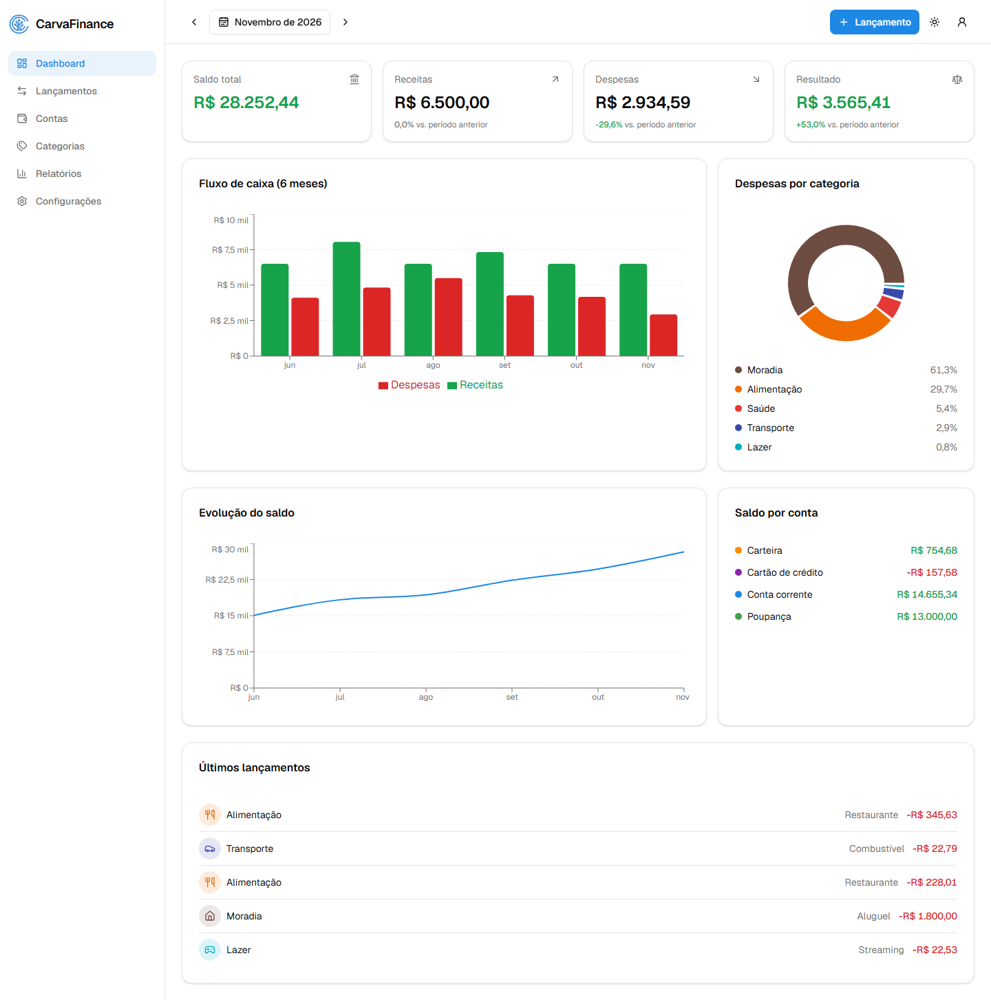
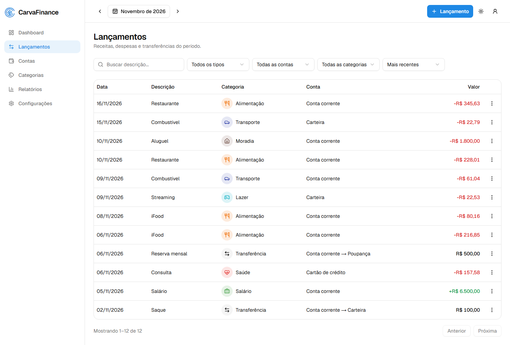
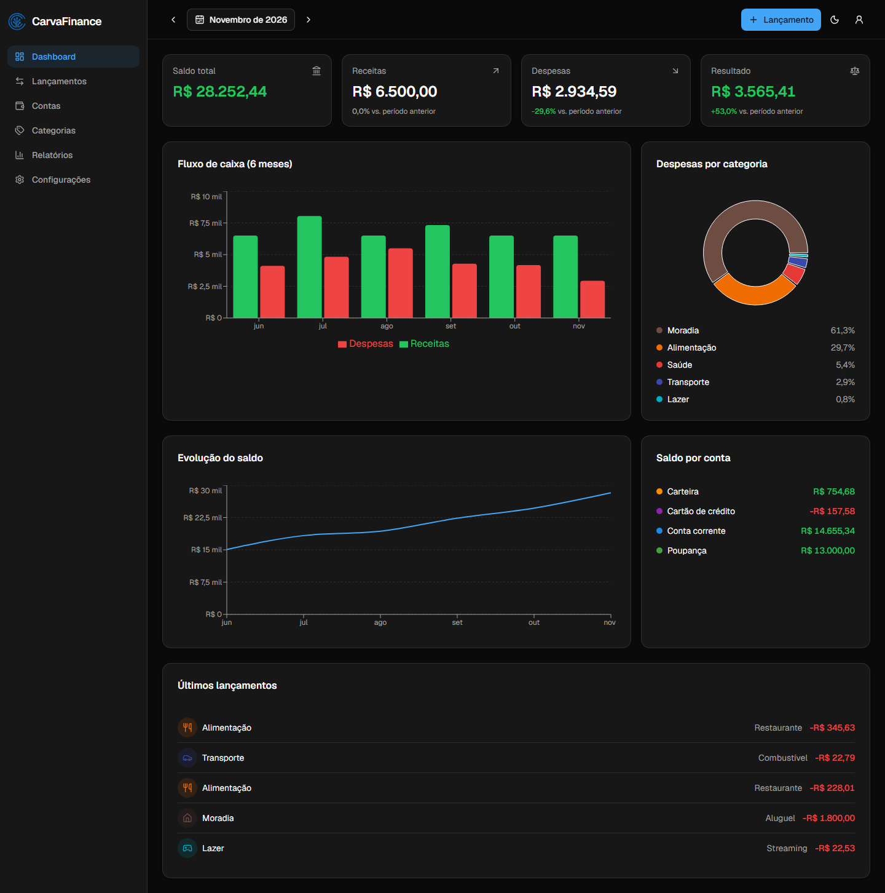
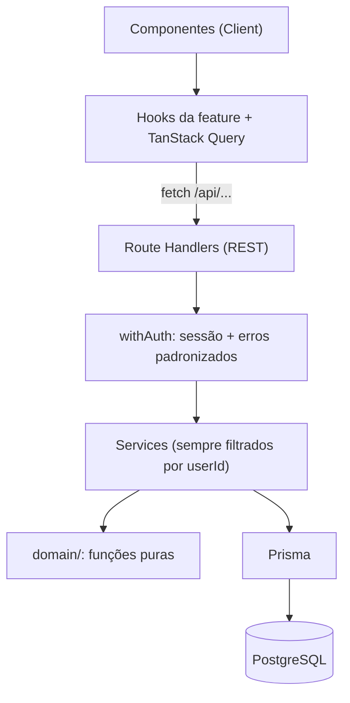

<p align="center">
  
</p>

<h1 align="center">CarvaFinance</h1>

<p align="center">
  Gerenciador financeiro pessoal full-stack: contas, receitas, despesas, transferências,
  categorias, dashboard com gráficos e relatórios — pronto para rodar com um comando.
</p>

<p align="center">
  <a href="https://github.com/Enz0Gabriel/carvafinance/actions/workflows/ci.yml"></a>
  
  
  
</p>



## Funcionalidades

- **Autenticação** com e-mail e senha (senhas com hash, sessão em cookie `httpOnly`, limite de tentativas) e botão **"Entrar como demo"**.
- **Contas** (corrente, poupança, carteira, cartão, investimento) com saldo sempre calculado — nunca armazenado.
- **Receitas, despesas e transferências** com filtros por período, tipo, conta e categoria, busca e paginação.
- **Categorias** com subcategorias (1 nível), cores e ícones; categorias padrão criadas no cadastro.
- **Dashboard**: saldo total, receitas, despesas e resultado com variação sobre o período anterior, fluxo de caixa de 6 meses, despesas por categoria, evolução do saldo e saldo por conta.
- **Relatórios**: resumo mensal, por categoria, por conta, extrato e **exportação CSV** (abre corretamente no Excel em pt-BR).
- Tema claro/escuro, layout responsivo e componentes acessíveis.

<details>
<summary>Mais telas</summary>

| Lançamentos                                       | Relatórios                                  |
| ------------------------------------------------- | ------------------------------------------- |
|  |  |



</details>

## Como rodar

Requisito: [Docker](https://www.docker.com/).

```bash
git clone https://github.com/Enz0Gabriel/carvafinance.git
cd carvafinance
docker compose up --build
```

Abra http://localhost:3000 e clique em **Entrar como demo** (`demo@carvafinance.dev` / `demo12345`).
O Compose sobe o PostgreSQL, aplica as migrações, cria o usuário demo com 6 meses de dados e inicia o app.

> Para uso real, defina `BETTER_AUTH_SECRET` (32+ caracteres aleatórios) antes de subir.

## Desenvolvimento

```bash
docker compose up -d db          # só o banco
cp .env.example .env             # ajuste BETTER_AUTH_SECRET
npm install                      # também gera o Prisma Client
npx prisma migrate dev
npx prisma db seed               # usuário demo
npm run dev
```

| Script                               | O que faz                                            |
| ------------------------------------ | ---------------------------------------------------- |
| `npm run dev`                        | Servidor de desenvolvimento                          |
| `npm test`                           | Testes unitários e de componentes                    |
| `npm run test:coverage`              | Unitários com cobertura (mínimo 80% em `src/domain`) |
| `npm run test:integration`           | Services e rotas contra um PostgreSQL real           |
| `npm run test:e2e`                   | Fluxos completos no navegador (Playwright)           |
| `npm run lint` / `npm run typecheck` | Qualidade de código                                  |
| `npm run db:studio`                  | Prisma Studio                                        |

## Stack

**Next.js 16** (App Router) · **React 19** · **TypeScript** strict · **Tailwind CSS v4** + **shadcn/ui** (Radix) ·
**PostgreSQL 17** + **Prisma 7** · **Better Auth** · **Zod** · **TanStack Query** · **Recharts** · **date-fns** ·
**Vitest** + Testing Library · **Playwright** · **Docker Compose** · **GitHub Actions**

## Arquitetura



- **Feature-based**: `src/features/<feature>` (UI, hooks, schemas), `src/server` (auth, services), `src/domain` (regras puras).
- **Dinheiro em centavos inteiros** do banco à tela; formatação só na exibição.
- **Integridade no banco**: `CHECK` garante valor positivo e o formato de transferências; saldo é sempre derivado.
- **Isolamento entre usuários**: o `userId` vem só da sessão; recurso de outro usuário responde `404`.
- **Filtros na URL**: período e filtros sobrevivem a recarregar e compartilhar o link.

## API

Todas as rotas exigem sessão e respondem JSON. Erros: `{ "error": { "code", "message", "details?" } }`.

| Método                 | Rota                                                 | Descrição                                                          |
| ---------------------- | ---------------------------------------------------- | ------------------------------------------------------------------ |
| `*`                    | `/api/auth/*`                                        | Cadastro, login, logout, sessão                                    |
| `GET` `POST`           | `/api/accounts`                                      | Lista (com saldo) / cria                                           |
| `GET` `PATCH` `DELETE` | `/api/accounts/:id`                                  | Detalha / edita / exclui ou arquiva                                |
| `GET` `POST`           | `/api/categories`                                    | Lista em árvore (`?kind=`) / cria                                  |
| `PATCH` `DELETE`       | `/api/categories/:id`                                | Edita / exclui ou arquiva                                          |
| `GET` `POST`           | `/api/transactions`                                  | Lista filtrada e paginada / cria receita, despesa ou transferência |
| `GET` `PATCH` `DELETE` | `/api/transactions/:id`                              | Detalha / edita / exclui                                           |
| `GET`                  | `/api/dashboard?from&to`                             | Dados do dashboard                                                 |
| `GET`                  | `/api/reports/{monthly,categories,accounts}?from&to` | Relatórios                                                         |
| `GET`                  | `/api/reports/export?from&to`                        | Download CSV                                                       |

## Segurança

Hash de senha e sessões pelo Better Auth, rate limiting no login, validação Zod em todas as rotas +
`CHECK` no banco, Prisma com consultas parametrizadas, cabeçalhos de segurança (CSP, `X-Frame-Options`,
`nosniff`, `Referrer-Policy`), proteção contra _CSV injection_, segredos fora do repositório e
`npm audit` + Dependabot no CI.

## Licença

MIT
