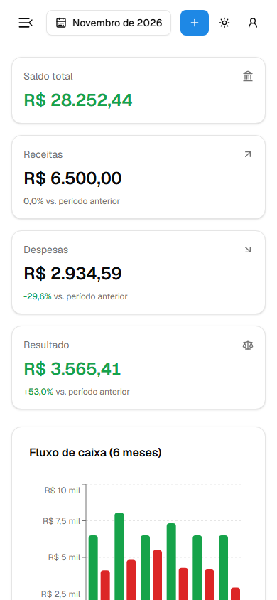
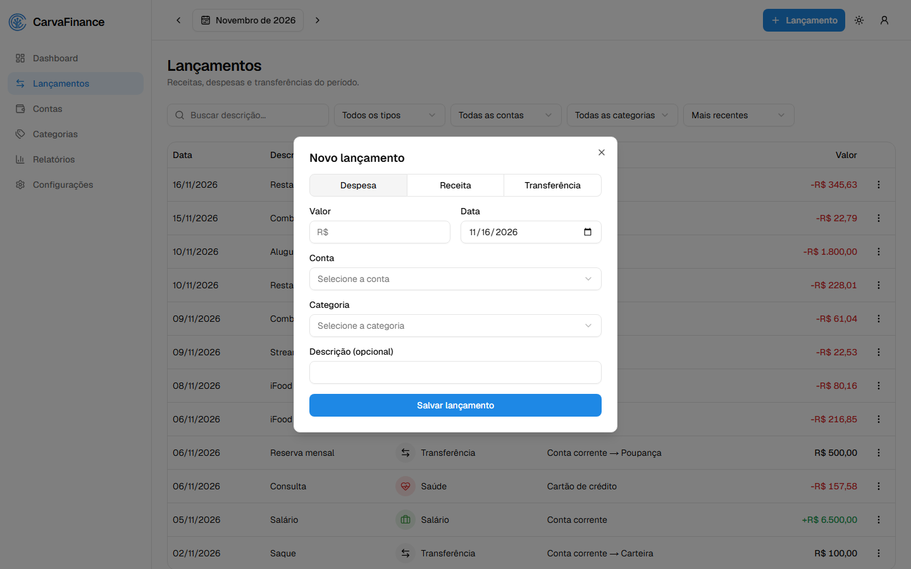
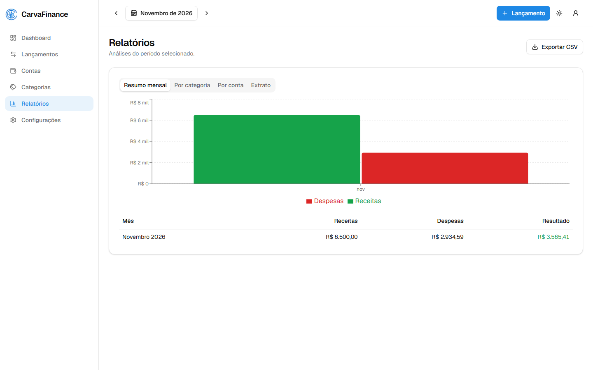
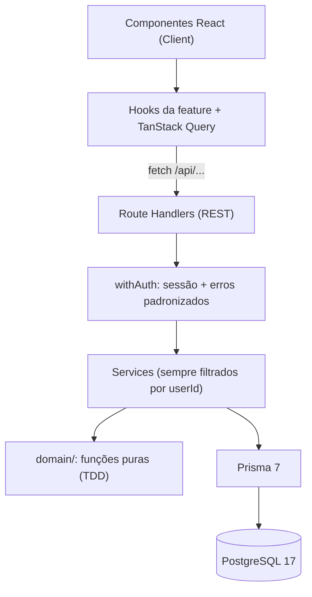

<div align="center">


# CarvaFinance

**Controle financeiro pessoal full-stack, rápido, seguro e pronto para rodar com um comando.**

[](https://github.com/Enz0Gabriel/carvafinance/actions/workflows/ci.yml)


<br />

[Funcionalidades](#-funcionalidades) •
[Galeria](#-galeria-de-telas) •
[Como rodar](#-como-rodar-com-docker) •
[Guia de uso](#-como-usar-o-sistema) •
[Arquitetura](#-arquitetura) •
[API](#-api-rest) •
[Testes](#-testes-e-qualidade)

<br />


</div>

---

## Sobre o Projeto

O **CarvaFinance** foi projetado com foco em **integridade financeira**, **segurança** e **experiência de uso real**:

- **Precisão absoluta com dinheiro:** valores são armazenados e calculados exclusivamente em **centavos inteiros** (`Int`), eliminando erros de arredondamento de ponto flutuante.
- **Saldo sempre consistente:** o saldo de cada conta nunca é armazenado em coluna fixa — é derivado dinamicamente a partir do saldo inicial, receitas, despesas e transferências.
- **Blindagem em duas camadas:** validação com **Zod** na interface e na API + constraints **`CHECK`** no PostgreSQL (valores positivos, transferências com origem ≠ destino e sem categoria).
- **Isolamento multi-usuário:** o `userId` é obtido exclusivamente da sessão autenticada no servidor (`withAuth`). Tentativas de acessar recursos de outro usuário retornam `404`.
- **Experiência pronta para testar:** conta de demonstração populada automaticamente com 6 meses de movimentações realistas.

---

## Funcionalidades

| Módulo                    | O que oferece                                                                                                                                                                             |
| :------------------------ | :---------------------------------------------------------------------------------------------------------------------------------------------------------------------------------------- |
| **Autenticação**          | Cadastro e login com e-mail/senha, hash seguro, sessão via cookie `httpOnly`, rate limiting e botão **"Entrar como demo"**.                                                               |
| **Dashboard**             | Saldo total consolidado, receitas, despesas e resultado com variação `%` vs. período anterior, fluxo de caixa (6 meses), despesas por categoria, evolução do saldo e últimos lançamentos. |
| **Lançamentos**           | Receitas, despesas e transferências entre contas, entrada monetária pt-BR (`1.234,56`), busca por descrição, ordenação, paginação no servidor e exclusão otimista.                        |
| **Contas**                | Corrente, Poupança, Carteira, Cartão de Crédito e Investimento. Contas com histórico são **arquivadas** em vez de apagadas.                                                               |
| **Categorias**            | 12 categorias padrão criadas no cadastro, suporte a subcategorias (1 nível), cores e ícones personalizáveis.                                                                              |
| **Relatórios & CSV**      | Resumo mensal, comparativo por categoria, fluxo por conta, extrato completo e download **CSV** compatível com Excel pt-BR (UTF-8 BOM, `;`, proteção contra _CSV injection_).              |
| **Tema & Responsividade** | Tema Claro, Escuro e Sistema, filtros sincronizados na URL e layout adaptado para desktop e mobile.                                                                                       |

---

## Galeria de Telas

<details open>
<summary><b>Tema Escuro & Versão Mobile</b></summary>

<br />

|                         Dashboard (Tema Escuro)                          |                                  Mobile                                   |
| :----------------------------------------------------------------------: | :-----------------------------------------------------------------------: |
|  |  |

</details>

<details>
<summary><b>Lançamentos, Novo Lançamento e Relatórios</b></summary>

<br />

|                            Lançamentos                            |                             Novo Lançamento                              |
| :---------------------------------------------------------------: | :----------------------------------------------------------------------: |
|  |  |

|                         Relatórios                          |                            Login                             |
| :---------------------------------------------------------: | :----------------------------------------------------------: |
|  |  |

</details>

<details>
<summary><b>Contas e Categorias</b></summary>

<br />

|                          Contas                          |                           Categorias                           |
| :------------------------------------------------------: | :------------------------------------------------------------: |
|  |  |

</details>

---

## Como rodar com Docker

A maneira mais rápida de testar o projeto completo (PostgreSQL 17 + migrações + seed demo + aplicação Next.js).

**Pré-requisito:** [Docker Desktop](https://www.docker.com/products/docker-desktop/) instalado e em execução.

```bash
# 1. Clone o repositório
git clone https://github.com/Enz0Gabriel/carvafinance.git
cd carvafinance

# 2. Suba o banco, migrações, dados demo e o app
docker compose up --build
```

Acesse **http://localhost:3000** e clique em **"Entrar como demo"** (ou use `demo@carvafinance.dev` / `demo12345`).

> **Em produção:** defina a variável `BETTER_AUTH_SECRET` com pelo menos 32 caracteres aleatórios antes de subir.

---

## Como usar o sistema

1. **Entrar ou cadastrar:** clique em **"Entrar como demo"** para explorar os 6 meses de dados prontos ou em **"Cadastre-se"** para criar uma conta nova (que já nasce com 12 categorias padrão).
2. **Gerenciar Contas (`/accounts`):** cadastre suas contas com tipo, saldo inicial e cor. Contas com movimentações são arquivadas ao excluir, mantendo o histórico intacto.
3. **Organizar Categorias (`/categories`):** crie categorias e subcategorias de 1 nível (ex.: _Alimentação › Restaurantes_) separadas por Receitas e Despesas.
4. **Registrar Lançamentos (`+ Lançamento`):** registre receitas, despesas ou **transferências entre contas** (que atualizam os saldos individuais sem distorcer os totais de receitas e despesas).
5. **Filtrar Períodos:** use o seletor no cabeçalho (`◀ ▶` ou atalhos _Este mês, Mês passado, Últimos 3/6 meses, Este ano, Personalizado_). O filtro fica salvo na URL e acompanha sua navegação entre _Dashboard_, _Lançamentos_ e _Relatórios_.
6. **Exportar Relatórios (`/reports`):** analise por mês, categoria, conta ou extrato e clique em **Exportar CSV** para abrir os dados diretamente no Excel.

---

## Desenvolvimento Local

Para rodar fora do container com hot reload:

```bash
docker compose up -d db          # Sobe apenas o PostgreSQL
cp .env.example .env             # Configure as variáveis locais
npm install                      # Instala dependências e gera o Prisma Client
npx prisma migrate dev           # Aplica o schema no banco
npx prisma db seed               # Popula o usuário demo
npm run dev                      # Inicia em http://localhost:3000
```

<details>
<summary><b>Comandos disponíveis no package.json</b></summary>

| Script                               | Descrição                                                    |
| :----------------------------------- | :----------------------------------------------------------- |
| `npm run dev`                        | Servidor de desenvolvimento Next.js                          |
| `npm run build`                      | Build de produção (`standalone`)                             |
| `npm test`                           | Testes unitários e de componentes (Vitest + Testing Library) |
| `npm run test:coverage`              | Cobertura das regras de domínio (`src/domain`, mínimo 80%)   |
| `npm run test:integration`           | Testes contra PostgreSQL real (`carvafinance_test`)          |
| `npm run test:e2e`                   | Fluxos completos no navegador (Playwright)                   |
| `npm run lint` / `npm run typecheck` | ESLint e verificação estrita do TypeScript                   |
| `npm run db:studio`                  | Abre o Prisma Studio para visualizar o banco                 |

</details>

---

## Arquitetura



<details>
<summary><b>Estrutura de pastas</b></summary>

```text
carvafinance/
├── prisma/
│   ├── schema.prisma          # Modelos, enums e índices
│   ├── migrations/            # SQL versionado + CHECK constraints
│   └── seed.ts                # Seed idempotente do usuário demo
├── src/
│   ├── app/
│   │   ├── (auth)/            # Login e Cadastro
│   │   ├── (app)/             # Páginas autenticadas (Dashboard, Lançamentos, Contas, etc.)
│   │   └── api/               # Route Handlers REST
│   ├── domain/                # Regras puras (money, period, balance, reports, csv)
│   ├── features/              # Módulos por funcionalidade (components, hooks, schemas)
│   ├── server/                # Auth, DB, HTTP guard (withAuth) e services
│   └── shared/                # UI (shadcn/ui), layout, feedback e hooks compartilhados
└── tests/
    ├── integration/           # Services, rotas e constraints contra Postgres real
    └── e2e/                   # Fluxos ponta a ponta (Playwright)
```

</details>

---

## API REST

Todas as rotas (exceto `/api/auth/*`) exigem sessão autenticada e retornam erros no padrão `{ "error": { "code", "message", "details?" } }`.

| Método                 | Rota                                                 | Descrição                                                          |
| :--------------------- | :--------------------------------------------------- | :----------------------------------------------------------------- |
| `*`                    | `/api/auth/*`                                        | Cadastro, login, logout, perfil e troca de senha                   |
| `GET` `POST`           | `/api/accounts`                                      | Lista contas com saldo atual / cria conta                          |
| `GET` `PATCH` `DELETE` | `/api/accounts/:id`                                  | Detalha / edita / exclui ou arquiva conta                          |
| `GET` `POST`           | `/api/categories`                                    | Lista árvore de categorias (`?kind=`) / cria categoria             |
| `PATCH` `DELETE`       | `/api/categories/:id`                                | Edita / exclui ou arquiva categoria                                |
| `GET` `POST`           | `/api/transactions`                                  | Lista filtrada e paginada / cria receita, despesa ou transferência |
| `GET` `PATCH` `DELETE` | `/api/transactions/:id`                              | Detalha / edita / exclui lançamento                                |
| `GET`                  | `/api/dashboard?from&to`                             | Resumo, comparativos, fluxo de caixa e saldo por conta             |
| `GET`                  | `/api/reports/{monthly,categories,accounts}?from&to` | Relatórios agregados                                               |
| `GET`                  | `/api/reports/export?from&to`                        | Download do extrato em CSV                                         |

---

## Testes e Segurança

- **Pirâmide de testes completa:** **75** testes unitários/de componentes (**91,15%** de cobertura em `src/domain`), **38** testes de integração contra PostgreSQL real e **3** fluxos E2E com Playwright.
- **Segurança:** senhas com hash, cookies `httpOnly` + `sameSite`, rate limiting no login, CSP restritiva, `X-Frame-Options: DENY`, `X-Content-Type-Options: nosniff`, ESLint bloqueando `dangerouslySetInnerHTML`, `any` e `$queryRawUnsafe`, além de Dependabot e `npm audit` no CI.

---

<div align="center">

Desenvolvido por **[Enzo Gabriel](https://github.com/Enz0Gabriel)** • Licença **MIT**

</div>
