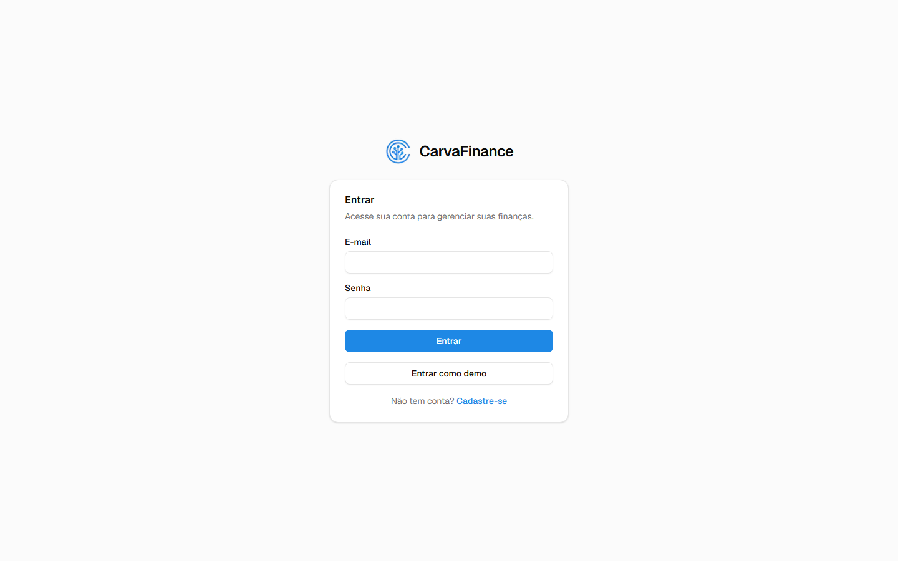
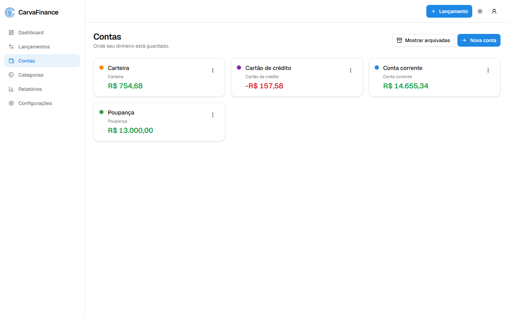
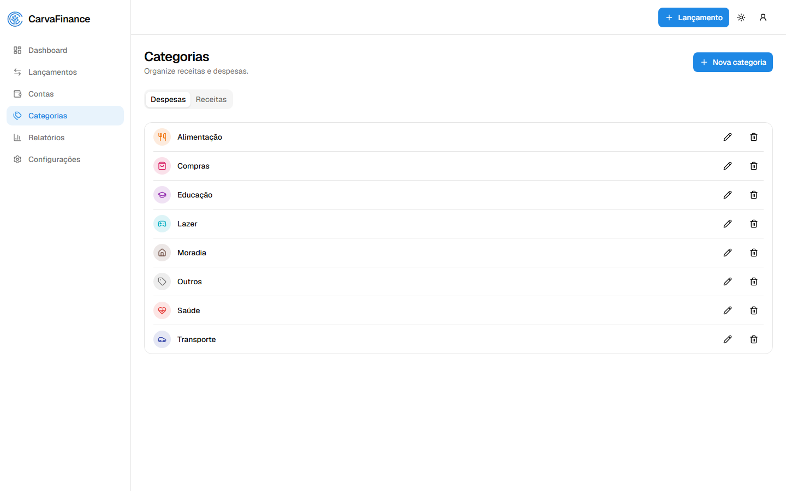
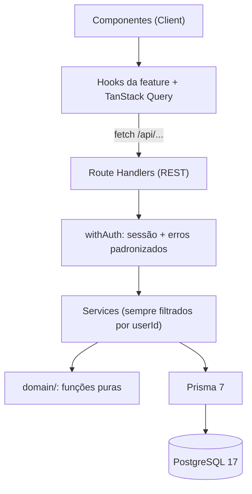

<p align="center">
  
</p>

<h1 align="center">CarvaFinance</h1>

<p align="center">
  Sistema completo de controle financeiro pessoal: contas, receitas, despesas, transferências entre contas,
  categorias com subcategorias, dashboard interativo, filtros por período e relatórios com exportação CSV.
</p>

<p align="center">
  <a href="https://github.com/Enz0Gabriel/carvafinance/actions/workflows/ci.yml"></a>
  
  
  
  
  
</p>

<p align="center">
  <a href="#como-rodar-com-docker">Como rodar</a> •
  <a href="#como-usar-o-sistema">Guia de uso</a> •
  <a href="#desenvolvimento-local">Desenvolvimento</a> •
  <a href="#arquitetura">Arquitetura</a> •
  <a href="#api-rest">API</a> •
  <a href="#segurança">Segurança</a>
</p>


---

## Sumário de Funcionalidades

- **Autenticação segura:** cadastro com e-mail/senha (hash, sessão em cookie `httpOnly`, limite de tentativas) e botão **"Entrar como demo"** com 6 meses de dados realistas já preenchidos.
- **Contas financeiras:** Conta Corrente, Poupança, Carteira, Cartão de Crédito e Investimento, com cor personalizada e **saldo calculado em tempo real** (nunca armazenado). Contas com histórico são arquivadas para preservar a integridade dos dados.
- **Receitas, despesas e transferências:** formulário unificado com entrada em formato brasileiro (`1.234,56`), tabela com busca por descrição, ordenação, filtros combinados (período, tipo, conta, categoria) e paginação no servidor.
- **Categorias e subcategorias:** 12 categorias padrão criadas automaticamente no cadastro, suporte a subcategorias (1 nível), ícones e cores personalizáveis.
- **Dashboard analítico:** cards de saldo total, receitas, despesas e resultado com variação percentual em relação ao período anterior, fluxo de caixa (6 meses), despesas por categoria (rosca), evolução do saldo e saldo por conta.
- **Relatórios e exportação CSV:** resumo mensal, comparativo por categoria, movimentação por conta, extrato completo e download CSV pronto para abrir no Excel em pt-BR (UTF-8 BOM, separador `;`, proteção contra _CSV injection_).
- **UX/UI:** tema claro, escuro e automático do sistema, responsivo para celular e desktop, atalhos de período sincronizados na URL.

---

## Como rodar com Docker

A forma mais simples de subir o projeto completo (PostgreSQL + migrações + dados demo + aplicação).

**Pré-requisitos:** [Docker Desktop](https://www.docker.com/products/docker-desktop/) instalado e aberto.

```bash
git clone https://github.com/Enz0Gabriel/carvafinance.git
cd carvafinance
docker compose up --build
```

Acesse **http://localhost:3000** no navegador e clique em **"Entrar como demo"** (ou use `demo@carvafinance.dev` / `demo12345`).

> **Nota de produção:** antes de publicar em um servidor real, defina a variável `BETTER_AUTH_SECRET` com pelo menos 32 caracteres aleatórios (`npx @better-auth/cli secret`).

---

## Como usar o sistema

### 1. Entrar ou criar uma conta

Na tela inicial (`/login`), você pode:

- Clicar em **"Entrar como demo"** para explorar imediatamente com 6 meses de dados de exemplo (salário, aluguel, compras, cartão e transferências para poupança).
- Ou clicar em **"Cadastre-se"** para criar sua própria conta limpa — ela já começa com 12 categorias padrão configuradas.

<details>
<summary>Ver tela de login e versão mobile</summary>

|            Tela de Login             |             Versão Mobile              |
| :----------------------------------: | :------------------------------------: |
|  |  |

</details>

### 2. Cadastrar suas Contas

Acesse **Contas** no menu lateral e clique em **Nova conta**:

- Escolha o nome (ex.: _Conta Nubank_, _Carteira_, _Poupança_), o tipo, o saldo inicial e uma cor.
- **Dica:** para excluir uma conta que já tem lançamentos, o sistema **arquiva** a conta automaticamente para não apagar o histórico financeiro. Você pode exibir/desarquivar contas a qualquer momento em _"Mostrar arquivadas"_.

<details>
<summary>Ver tela de Contas e Categorias</summary>

|                  Contas                  |                   Categorias                   |
| :--------------------------------------: | :--------------------------------------------: |
|  |  |

</details>

### 3. Registrar Receitas, Despesas e Transferências

Em qualquer tela, clique no botão **+ Lançamento** no cabeçalho:

- **Despesa / Receita:** informe o valor em reais (`45,90` ou `1.250,00`), a data, a conta, a categoria e uma descrição opcional.
- **Transferência:** escolha a **conta de origem** e a **conta de destino**. Transferências movimentam o saldo entre suas contas sem inflar os totais de receitas ou despesas do dashboard.

<details>
<summary>Ver formulário de Novo Lançamento e tabela de Lançamentos</summary>

|                     Novo Lançamento                      |               Lista de Lançamentos                |
| :------------------------------------------------------: | :-----------------------------------------------: |
|  |  |

</details>

### 4. Analisar o Dashboard e Filtrar Períodos

- Use o **seletor de período** no topo (setas `◀ ▶` ou atalhos _Este mês, Mês passado, Últimos 3/6 meses, Este ano, Personalizado_). O período escolhido fica salvo na URL e acompanha você entre _Dashboard_, _Lançamentos_ e _Relatórios_.
- No **Dashboard**, acompanhe o saldo total consolidado, a variação percentual vs. período anterior, o fluxo de caixa dos últimos 6 meses e onde você mais gastou por categoria.


### 5. Gerar Relatórios e Exportar CSV

Acesse **Relatórios** no menu lateral para alternar entre **Resumo mensal**, **Por categoria**, **Por conta** e **Extrato**, ou clique em **Exportar CSV** para baixar todos os lançamentos do período selecionado em planilha.


---

## Desenvolvimento local

Se quiser rodar o código em modo de desenvolvimento (com hot reload):

```bash
# 1. Suba apenas o PostgreSQL no Docker
docker compose up -d db

# 2. Configure as variáveis de ambiente
cp .env.example .env

# 3. Instale as dependências (também gera o Prisma Client)
npm install

# 4. Aplique as migrações e crie os dados de demonstração
npx prisma migrate dev
npx prisma db seed

# 5. Inicie o servidor
npm run dev
```

| Script                               | O que faz                                                      |
| ------------------------------------ | -------------------------------------------------------------- |
| `npm run dev`                        | Servidor de desenvolvimento (Next.js)                          |
| `npm run build`                      | Build de produção (`standalone`)                               |
| `npm test`                           | Testes unitários e de componentes (Vitest + Testing Library)   |
| `npm run test:coverage`              | Cobertura das regras de domínio (mínimo 80%)                   |
| `npm run test:integration`           | Testes de serviços, rotas e constraints contra PostgreSQL real |
| `npm run test:e2e`                   | Testes ponta a ponta no navegador (Playwright)                 |
| `npm run lint` / `npm run typecheck` | ESLint e verificação estrita do TypeScript                     |
| `npm run db:studio`                  | Abre o Prisma Studio para inspecionar o banco                  |

---

## Stack tecnológica

- **Front-end & API:** Next.js 16 (App Router) · React 19 · TypeScript (`strict`) · Tailwind CSS v4 · shadcn/ui (Radix UI) · Recharts · TanStack Query v5 · React Hook Form · date-fns · lucide-react
- **Back-end & Banco:** PostgreSQL 17 · Prisma 7 · Better Auth · Zod 4
- **Qualidade & Infra:** Vitest · Testing Library · Playwright · ESLint · Prettier · Husky · Docker & Docker Compose · GitHub Actions

---

## Arquitetura



- **Organização por feature:** `src/features/<nome>` agrupa UI, hooks e schemas; `src/server` concentra autenticação e regras de negócio; `src/domain` contém apenas funções puras testadas com TDD.
- **Precisão financeira:** valores monetários trafegam e são armazenados exclusivamente em **centavos inteiros** (`Int`), sem aritmética de ponto flutuante.
- **Integridade garantida no banco:** constraints `CHECK` no PostgreSQL validam valores positivos (`amount_cents > 0`) e o formato das transferências (`to_account_id <> account_id`, sem categoria).
- **Datas sem erro de fuso horário:** datas de lançamento são calendário (`@db.Date`), convertidas em UTC meia-noite (`toDbDate`/`fromDbDate`).

---

## API REST

Todas as rotas (exceto `/api/auth/*`) exigem sessão autenticada e respondem JSON no padrão `{ "error": { "code", "message", "details?" } }` em caso de erro.

| Método                 | Rota                                                 | Descrição                                                          |
| ---------------------- | ---------------------------------------------------- | ------------------------------------------------------------------ |
| `*`                    | `/api/auth/*`                                        | Cadastro, login, logout, atualização de perfil e troca de senha    |
| `GET` `POST`           | `/api/accounts`                                      | Lista contas com saldo atual / cria conta                          |
| `GET` `PATCH` `DELETE` | `/api/accounts/:id`                                  | Detalha / edita / exclui ou arquiva conta                          |
| `GET` `POST`           | `/api/categories`                                    | Lista árvore de categorias (`?kind=`) / cria categoria             |
| `PATCH` `DELETE`       | `/api/categories/:id`                                | Edita / exclui ou arquiva categoria                                |
| `GET` `POST`           | `/api/transactions`                                  | Lista filtrada e paginada / cria receita, despesa ou transferência |
| `GET` `PATCH` `DELETE` | `/api/transactions/:id`                              | Detalha / edita / exclui lançamento                                |
| `GET`                  | `/api/dashboard?from&to`                             | Cards, comparativos, fluxo de caixa, categorias, evolução e saldos |
| `GET`                  | `/api/reports/{monthly,categories,accounts}?from&to` | Relatórios agregados                                               |
| `GET`                  | `/api/reports/export?from&to`                        | Download do extrato em CSV                                         |

---

## Segurança

- **Isolamento multi-usuário:** o `userId` é extraído exclusivamente da sessão no servidor (`withAuth`); tentativas de acessar recursos ou referenciar contas/categorias de outro usuário retornam `404`.
- **Proteção de sessão e senhas:** hash seguro e cookies `httpOnly`, `sameSite` com _rate limiting_ no login (Better Auth).
- **Validação dupla:** Zod no cliente e na API + `CHECK` constraints no PostgreSQL.
- **Hardening HTTP e código:** CSP restritiva, `X-Frame-Options: DENY`, `X-Content-Type-Options: nosniff`, `Referrer-Policy`, ESLint proibindo `dangerouslySetInnerHTML`, `any` e `$queryRawUnsafe`, além de neutralização contra _CSV injection_ nas exportações.

---

## Licença

MIT
