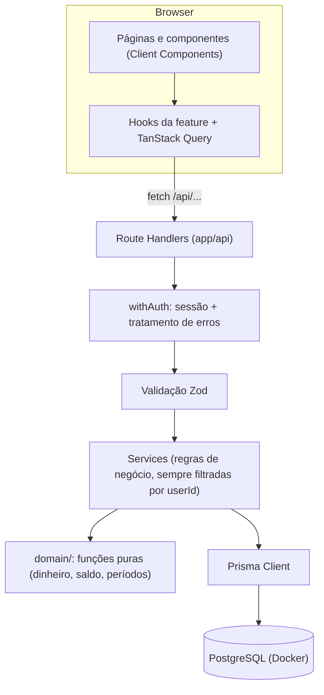
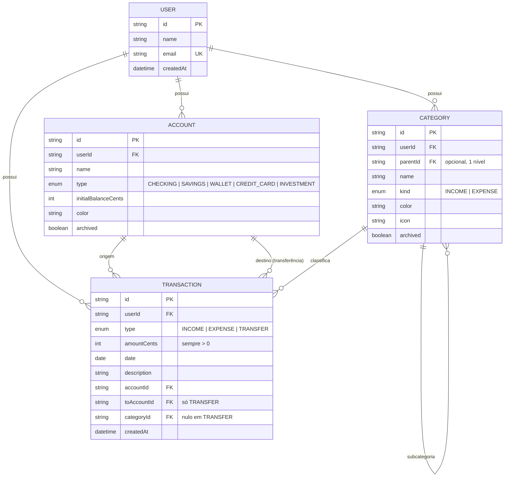
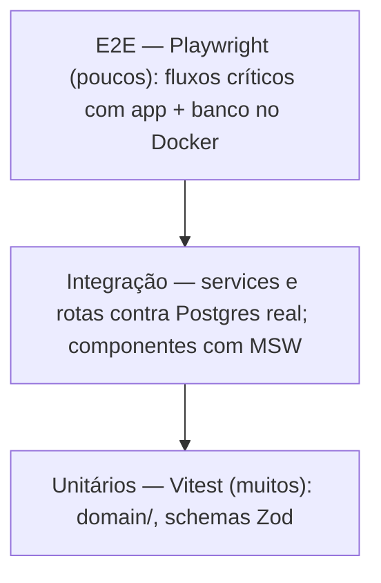
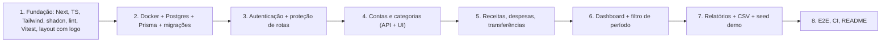

# CarvaFinance — Planejamento Técnico (v3: full-stack com Next.js + Docker)


> [!NOTE]
> **Situação atual:** a pasta `c:\projects\carvafinance` está **vazia**. **Objetivo:** projeto full-stack de portfólio no GitHub, que qualquer pessoa sobe com **um comando** (`docker compose up`).

---

## 1. Objetivo e escopo

Aplicação full-stack de finanças pessoais: cada usuário tem login e seus próprios dados (contas, categorias, receitas, despesas, transferências), além de dashboard com gráficos, filtros por período e relatórios.

| | |
|---|---|
| **Metas (v1)** | Cadastro/login, contas, categorias, receitas, despesas, transferências, dashboard, filtros por período, relatórios, exportação CSV, API REST, Docker, usuário de demonstração com dados de exemplo |
| **Fora do escopo** | Multi-moeda, orçamentos/metas, recorrência automática, Open Finance, app mobile, login social |
| **O que seria um fracasso** | Saldo errado por arredondamento; um usuário enxergar dados de outro; o projeto não subir com `docker compose up` em uma máquina limpa |

> [!IMPORTANT]
> **"Contas"** (Conta Corrente, Poupança, Carteira, Cartão…) são a entidade central, porque toda transferência precisa de origem e destino.

---

## 2. Stack tecnológica

| Área | Tecnologia | Por quê |
|---|---|---|
| Framework | **Next.js (App Router) + React 19 + TypeScript strict** | Front-end e API em um só projeto |
| Estilo | **Tailwind CSS v4 + shadcn/ui** (Radix) | Visual profissional e acessível, código dentro do projeto |
| API | **Route Handlers** do Next (`app/api/**/route.ts`) | Rotas REST explícitas |
| Banco | **PostgreSQL 17** no Docker | Banco relacional robusto |
| ORM | **Prisma** | Schema tipado, migrações versionadas, proteção contra SQL injection |
| Autenticação | **Better Auth** (e-mail + senha, adaptador Prisma) | Cadastro, login e sessão prontos, senhas com hash, cookies seguros |
| Validação | **Zod** | O mesmo schema valida no formulário (cliente) e na API (servidor) |
| Dados no cliente | **TanStack Query** | Cache, loading/erro, invalidação após criar/editar |
| Formulários | **React Hook Form** + Zod | |
| Gráficos | **Recharts** | |
| Datas | **date-fns** (pt-BR) | |
| Ícones | **lucide-react** | |
| Testes | **Vitest + Testing Library + MSW + Playwright** | Ver seção 10 |
| Qualidade | **ESLint + Prettier + Husky + lint-staged** | |
| Infra | **Docker + Docker Compose**, **GitHub Actions** | Ambiente reproduzível e CI |

**Identidade visual:** azul primário extraído da logo (~`#1E88E5`), verde para receitas, vermelho para despesas, neutros cinza-azulados, tema claro/escuro. A logo aparece na sidebar, nas telas de login/cadastro, no favicon e no README.

---

## 3. Arquitetura



**Regras da arquitetura:**
1. **Route Handlers são finos:** autenticam, validam com Zod, chamam um *service* e devolvem JSON. Regra de negócio fica só nos services.
2. **Todo service recebe o `userId`** e filtra por ele em todas as consultas. Não existe consulta sem dono.
3. **Componentes não chamam `fetch` diretamente.** Usam hooks da feature (`useTransactions`, `useCreateTransaction`), que usam TanStack Query.
4. **Dinheiro sempre em centavos inteiros** (`1599` = R$ 15,99), formatado só na tela com `Intl.NumberFormat('pt-BR')`.
5. **Filtros na URL** (`/transactions?from=2026-11-01&to=2026-11-30&accountId=...`).
6. Server Components para layout e proteção de páginas; Client Components onde há interação.
7. Simplicidade: nada de abstração antes do segundo caso de uso.

---

## 4. Estrutura de pastas

```text
carvafinance/
├── .github/workflows/ci.yml          # lint, typecheck, testes (com Postgres), build
├── docker-compose.yml                # db + app
├── Dockerfile                        # multi-stage, output standalone, usuário não-root
├── .env.example
├── prisma/
│   ├── schema.prisma
│   ├── migrations/
│   └── seed.ts                       # usuário demo + 6 meses de dados
├── public/
│   └── logo.webp
├── src/
│   ├── app/
│   │   ├── (auth)/
│   │   │   ├── login/page.tsx
│   │   │   └── register/page.tsx
│   │   ├── (app)/                    # área logada (layout com sidebar)
│   │   │   ├── layout.tsx            # verifica sessão no servidor
│   │   │   ├── dashboard/page.tsx
│   │   │   ├── transactions/page.tsx
│   │   │   ├── accounts/page.tsx
│   │   │   ├── categories/page.tsx
│   │   │   ├── reports/page.tsx
│   │   │   └── settings/page.tsx
│   │   ├── api/
│   │   │   ├── auth/[...all]/route.ts
│   │   │   ├── accounts/route.ts
│   │   │   ├── accounts/[id]/route.ts
│   │   │   ├── categories/route.ts
│   │   │   ├── categories/[id]/route.ts
│   │   │   ├── transactions/route.ts
│   │   │   ├── transactions/[id]/route.ts
│   │   │   ├── dashboard/route.ts
│   │   │   └── reports/[type]/route.ts
│   │   ├── layout.tsx
│   │   └── globals.css
│   ├── features/                     # código de UI por funcionalidade
│   │   ├── accounts/
│   │   │   ├── components/           # AccountList, AccountForm, AccountCard
│   │   │   ├── hooks/                # useAccounts, useCreateAccount...
│   │   │   ├── api-client.ts         # chamadas fetch tipadas
│   │   │   └── schemas.ts            # Zod (compartilhado com o servidor)
│   │   ├── categories/
│   │   ├── transactions/             # TransactionTable, TransactionForm,
│   │   │                             # TransferForm, TransactionFilters
│   │   ├── dashboard/                # SummaryCards, CashFlowChart,
│   │   │                             # ExpensesByCategoryChart, BalanceTrendChart
│   │   ├── reports/                  # MonthlyReport, CategoryReport, ExportCsvButton
│   │   └── auth/                     # LoginForm, RegisterForm
│   ├── server/                       # só roda no servidor
│   │   ├── db.ts                     # Prisma client (singleton)
│   │   ├── auth.ts                   # configuração Better Auth
│   │   ├── http.ts                   # withAuth, respostas e erros padronizados
│   │   └── services/
│   │       ├── accounts.service.ts
│   │       ├── categories.service.ts
│   │       ├── transactions.service.ts
│   │       ├── dashboard.service.ts
│   │       └── reports.service.ts
│   ├── domain/                       # funções puras
│   │   ├── money.ts
│   │   ├── period.ts
│   │   ├── balance.ts
│   │   ├── reports.ts
│   │   └── csv.ts
│   ├── shared/
│   │   ├── components/ui/            # shadcn
│   │   ├── components/layout/        # AppShell, Sidebar, Header
│   │   ├── components/feedback/      # EmptyState, ErrorState, ConfirmDialog
│   │   ├── hooks/                    # usePeriodFilter
│   │   └── lib/                      # utils, auth-client, query-client
│   └── middleware.ts                 # redireciona quem não está logado
├── tests/
│   ├── e2e/                          # Playwright
│   ├── integration/                  # services e rotas contra Postgres real
│   └── setup.ts
├── docs/
│   ├── screenshots/
│   └── superpowers/specs/            # este documento
└── README.md
```

---

## 5. Modelo de dados (Prisma)



*(As tabelas de sessão do Better Auth também ficam no schema, mas foram omitidas do diagrama.)*

**Regras garantidas em duas camadas (Zod no service + CHECK constraint no banco via migração SQL):**
- `amountCents > 0`; o sinal vem do `type`.
- `TRANSFER` ⇒ `toAccountId` obrigatório e diferente de `accountId`; `categoryId` nulo.
- `INCOME`/`EXPENSE` ⇒ categoria obrigatória e de `kind` compatível.
- Contas e categorias referenciadas pertencem ao **mesmo usuário** (checado no service).
- Conta ou categoria com lançamentos é **arquivada**, não apagada.

**Índices:** `(userId, date)`, `(userId, accountId)`, `(userId, categoryId)`.

**Saldo:** sempre calculado com `groupBy`/`aggregate` no banco, nunca armazenado:
saldo = inicial + receitas − despesas − transferências enviadas + transferências recebidas.
Transferências **não** entram nos totais de receitas e despesas.

---

## 6. Rotas da API (REST)

Todas exigem sessão (exceto `/api/auth/*`) e respondem JSON. Os erros seguem um formato único: `{ error: { code, message, details? } }`, com status 400, 401, 404, 409 e 500.

| Método | Rota | Descrição |
|---|---|---|
| `*` | `/api/auth/*` | Cadastro, login, logout, sessão (Better Auth) |
| `GET` | `/api/accounts` | Lista contas com saldo atual (`?archived=true`) |
| `POST` | `/api/accounts` | Cria conta |
| `GET` / `PATCH` / `DELETE` | `/api/accounts/:id` | Detalha / edita / exclui ou arquiva |
| `GET` | `/api/categories` | Lista (`?kind=EXPENSE`) |
| `POST` | `/api/categories` | Cria |
| `PATCH` / `DELETE` | `/api/categories/:id` | Edita / exclui ou arquiva |
| `GET` | `/api/transactions` | Lista paginada e filtrada: `from, to, type, accountId, categoryId, q, page, pageSize, sort` |
| `POST` | `/api/transactions` | Cria receita, despesa ou transferência (pelo `type`) |
| `GET` / `PATCH` / `DELETE` | `/api/transactions/:id` | Detalha / edita / exclui |
| `GET` | `/api/dashboard?from&to` | Cards, fluxo de caixa, despesas por categoria, evolução do saldo, saldo por conta |
| `GET` | `/api/reports/monthly?from&to` | Resumo mês a mês |
| `GET` | `/api/reports/categories?from&to&kind` | Totais e % por categoria, comparados ao período anterior |
| `GET` | `/api/reports/accounts?from&to` | Entradas, saídas e saldo por conta |
| `GET` | `/api/reports/export?from&to&format=csv` | Download CSV do extrato filtrado |

---

## 7. Funcionalidades

- **Autenticação:** cadastro (nome, e-mail, senha), login, logout. Categorias padrão criadas no cadastro. Na tela de login, um botão **"Entrar como demo"** usa o usuário do seed.
- **Receitas/Despesas:** formulário com alternância de tipo, valor com máscara BRL, data padrão hoje, conta, categoria e descrição. Tabela com busca, ordenação, filtros e paginação no servidor. Edição, exclusão com confirmação, toasts e atualização otimista.
- **Transferências:** formulário origem → destino, exibido na mesma lista com estilo neutro.
- **Categorias:** CRUD com cor, ícone, tipo e subcategoria opcional.
- **Contas:** CRUD com tipo, saldo inicial, cor e card de saldo atual.
- **Configurações:** perfil, troca de senha, tema.

---

## 8. Dashboard

```text
┌───────────────────────────────────────────────────────────────────────┐
│ [logo] CarvaFinance       ◀ [Novembro 2026 ▾] ▶   [+ Lançamento] (👤) │
├──────────────┬────────────────────────────────────────────────────────┤
│ Dashboard    │ ┌────────────┐ ┌────────────┐ ┌────────────┐ ┌───────┐ │
│ Lançamentos  │ │Saldo total │ │Receitas    │ │Despesas    │ │Result.│ │
│ Contas       │ │R$ 12.430   │ │R$ 8.200 ▲4%│ │R$ 5.140 ▼2%│ │+3.060 │ │
│ Categorias   │ └────────────┘ └────────────┘ └────────────┘ └───────┘ │
│ Relatórios   │ ┌───────────────────────────────┐ ┌──────────────────┐ │
│ Configurações│ │ Fluxo de caixa mensal (barras)│ │ Despesas por     │ │
│              │ └───────────────────────────────┘ │ categoria (rosca)│ │
│              │ ┌───────────────────────────────┐ └──────────────────┘ │
│              │ │ Evolução do saldo (linha)     │ ┌──────────────────┐ │
│              │ └───────────────────────────────┘ │ Saldo por conta  │ │
│              │ Últimos lançamentos               └──────────────────┘ │
└──────────────┴────────────────────────────────────────────────────────┘
```

- **Saldo total** soma todas as contas. Receitas, despesas e resultado respeitam o período, com variação % sobre o período anterior.
- Um único endpoint (`/api/dashboard`) devolve tudo, com as agregações feitas no Postgres.
- Estados de carregamento (skeleton), vazio e erro. Layout responsivo.

---

## 9. Filtros e relatórios

- **Filtro de período** (compartilhado): *Este mês, Mês passado, Últimos 3/6 meses, Este ano, Personalizado* + navegação ◀ ▶. Estado na URL via `usePeriodFilter`.
- **Relatórios:** resumo mensal, por categoria, por conta e extrato (rotas da seção 6), cada um com tabela e gráfico.
- **CSV** gerado no servidor: UTF-8 com BOM e separador `;`, para abrir corretamente no Excel em pt-BR.

---

## 10. Persistência, Docker e segurança

### Docker

```yaml
# docker-compose.yml (resumo)
services:
  db:
    image: postgres:17-alpine
    volumes: [pgdata:/var/lib/postgresql/data]
    healthcheck: pg_isready
  app:
    build: .
    depends_on: { db: { condition: service_healthy } }
    ports: ["3000:3000"]
    # na inicialização: prisma migrate deploy + seed (se o banco estiver vazio)
volumes:
  pgdata:
```

- **Uso completo:** `docker compose up --build` → abrir http://localhost:3000 → "Entrar como demo".
- **Desenvolvimento:** `docker compose up db` + `npm run dev` (hot reload no host).
- `Dockerfile` multi-stage com `output: 'standalone'`: imagem pequena, rodando como usuário não-root.
- Migrações versionadas em `prisma/migrations`. Prisma Studio para inspecionar o banco.

### Segurança

| Risco | Proteção |
|---|---|
| Usuário acessar dados de outro | `userId` vem **sempre da sessão**, nunca do corpo da requisição; todo service filtra por ele; recurso de outro usuário responde **404** |
| Senhas | Hash forte e sessão em cookie `httpOnly`, `secure`, `sameSite` (Better Auth) |
| Força bruta no login | Rate limiting do Better Auth nas rotas de autenticação |
| Dados inválidos | Zod em toda rota + CHECK constraints no banco |
| SQL injection | Prisma (consultas parametrizadas); proibido `$queryRawUnsafe` |
| XSS | React escapa por padrão; `dangerouslySetInnerHTML` proibido via ESLint; headers de segurança (CSP, `X-Frame-Options`, `Referrer-Policy`) no `next.config` |
| CSRF | Cookies `sameSite` + checagem de origem do Better Auth |
| Segredos | `.env` fora do git; `.env.example` documentado; variáveis validadas com Zod na inicialização |
| CSV injection | Escapar células iniciadas por `= + - @` |
| Dependências | Dependabot + `npm audit` no CI |

---

## 11. Estratégia de testes



| Nível | O que testar | Meta |
|---|---|---|
| Unitário | `money`, `period`, `balance`, `reports`, `csv`, schemas | ~100% em `domain/`, com **TDD** |
| Integração (servidor) | Services e Route Handlers contra um **Postgres de teste no Docker**: regras de transferência, saldo, arquivamento, filtros, paginação e **isolamento entre usuários** (A não acessa B) | Todas as regras das seções 5 e 6 |
| Componentes | Formulários (validação, envio), tabela com filtros, dashboard e estados vazio/erro, com MSW simulando a API | Comportamento do usuário |
| E2E | Cadastro → conta → receita, despesa, transferência → saldo no dashboard → filtro de período → CSV; login demo | Fluxos principais |

**CI (GitHub Actions):** Postgres como serviço → lint → typecheck → unitários → integração → build → E2E. Cobertura mínima de 80% e badge no README.

---

## 12. Boas práticas

- Componentes pequenos e de responsabilidade única; lógica em hooks; regras em services e funções puras.
- Route Handlers finos, com um helper `withAuth` padronizando autenticação e erros (sem repetição).
- TypeScript `strict`, sem `any`. Código em inglês, interface em pt-BR.
- Acessibilidade (Radix, labels, teclado, contraste).
- Commits convencionais e README completo (prints, GIF, arquitetura, como rodar, rotas da API).

---

## 13. Roteiro



Cada fase termina com testes passando e algo utilizável.

---

## 14. Decisões que tomei por conta própria (revise)

1. **Better Auth** para autenticação (alternativa: Auth.js, que tem suporte mais limitado a cadastro com e-mail e senha).
2. **API REST em Route Handlers + TanStack Query** no cliente, em vez de Server Actions, para deixar as rotas explícitas e testáveis.
3. **Prisma** como ORM (alternativa: Drizzle).
4. **Usuário demo** criado pelo seed, com botão "Entrar como demo".
5. Moeda única **BRL**, subcategorias com **1 nível**, **CSV** (sem PDF) na v1.
6. Recorrência e orçamentos **fora** da v1.
7. Deploy público (ex.: Vercel + Neon) **não** faz parte da v1; o foco é rodar com Docker.
